# django-app

[](https://github.com/filooww/django-app/actions)
[](https://github.com/filooww/django-app/actions/workflows/badges.yml)
[](https://github.com/filooww/django-gitops#progressive-delivery-and-automatic-rollback)
[](https://github.com/filooww/django-gitops)
[](https://github.com/filooww/django-app#deploy-to-aws-ec2-terraform--ansible)

Live data: `pipeline` and `CVE` come from GitHub Actions (`badges.yml`), `canary` and `k8s` from a CronJob in the cluster, `ec2` from the Ansible deploy. All of them write JSON to the `badges` branch.


A small Django application packaged as a Docker image. It is the application part of a DevOps assignment: the image is published to GitHub Container Registry and deployed in two ways:

- to a Kubernetes cluster with Helm and Argo CD (see [django-gitops](https://github.com/filooww/django-gitops));
- to two AWS EC2 instances with Terraform and Ansible (see [Deploy to AWS](#deploy-to-aws-ec2-terraform--ansible)).

Every request to `/` writes a row to PostgreSQL and returns the total number of visits, so it is easy to check that the app is connected to the database and that the data survives restarts.

## Project structure

```
django-app/
├── app/
│   ├── manage.py
│   ├── requirements.txt        # pinned dependencies (Django, psycopg, gunicorn)
│   ├── config/
│   │   ├── settings.py         # all settings come from environment variables
│   │   ├── urls.py
│   │   └── wsgi.py             # entry point for Gunicorn
│   └── core/
│       ├── models.py           # Visit model
│       ├── views.py            # /, /healthz, /readyz, /health/
│       └── migrations/
├── nginx/dev.conf              # reverse proxy config for local run
├── terraform/                  # AWS: state bucket, VPC, SGs, EC2, EBS, IAM, alarms
├── ansible/                    # EC2 configuration: PostgreSQL, Docker, Django, CloudWatch Agent
├── .github/workflows/
│   ├── ci.yml                  # Gitflow pipeline: lint, test, scan, push vX.Y.Z
│   ├── build-push.yaml         # push to main: image :latest and :<sha>
│   ├── iac.yml                 # PR checks for terraform/ and ansible/
│   └── badges.yml              # pipeline time and CVE count for the README badges
├── scripts/put-badge.sh        # writes one badge JSON to the badges branch
├── Dockerfile
├── docker-compose.yaml         # local run: PostgreSQL + migrations + app + nginx
├── .env.example                # example settings
├── .dockerignore
└── .gitignore
```

## Endpoints

| Path | Description | Used for |
|---|---|---|
| `/` | Saves a visit to PostgreSQL, returns JSON with app name, version, pod/container name and total visits | Checking DB connection, load balancing |
| `/healthz` | Always returns `ok`, does not touch the DB | Docker healthcheck, Kubernetes liveness probe |
| `/readyz` | `ready` if the DB is reachable and all migrations are applied, otherwise `503` | Kubernetes readiness probe |
| `/health/` | Same check as `/readyz` | Health check of the EC2 deployment |

Example response:

```json
{"app": "django-prod", "version": "1.0.2", "served_by": "django-django-6b99956757-8qz5r", "total_visits": 10}
```

## Configuration

All configuration is passed through environment variables, nothing environment-specific is stored in the image.

| Variable | Required | Default | Description |
|---|---|---|---|
| `DJANGO_SECRET_KEY` | yes | | Django secret key |
| `DB_PASSWORD` | yes | | PostgreSQL password |
| `DB_HOST` | no | `localhost` | PostgreSQL host (`db` in Compose, Service name in Kubernetes) |
| `DB_PORT` | no | `5432` | PostgreSQL port |
| `DB_NAME` | no | `app` | Database name |
| `DB_USER` | no | `app` | Database user |
| `DJANGO_DEBUG` | no | `False` | Debug mode |
| `DJANGO_ALLOWED_HOSTS` | no | `*` | Comma-separated list of allowed hosts |
| `APP_NAME`, `APP_VERSION` | no | | Shown in the `/` response |

For the PostgreSQL container (Compose only): `POSTGRES_DB`, `POSTGRES_USER`, `POSTGRES_PASSWORD`. They must match `DB_NAME`, `DB_USER`, `DB_PASSWORD`.

## Docker image

```
ghcr.io/filooww/django-app:<version>
```

- Official `python:3.12-slim` base image, multi-stage build (dependencies are installed into a venv in a separate stage).
- Runs as a non-root user `app` (UID 999).
- No credentials inside the image: `.env` is excluded by `.dockerignore`, all secrets come from environment variables at runtime.
- Started with **Gunicorn**: `gunicorn config.wsgi:application --bind 0.0.0.0:8000 --workers 2`.
- Logs go to stdout, so they are visible in `docker logs` / `kubectl logs`.
- Migrations are a separate command: `python manage.py migrate --noinput` (a one-shot service in Compose, a Job in Kubernetes).

Build and publish a new version:

```bash
docker build -t ghcr.io/filooww/django-app:1.0.2 .
docker push ghcr.io/filooww/django-app:1.0.2
```

Published tags are never overwritten: every change gets a new version.

## Run locally with Docker Compose

```bash
cp .env.example .env      # then change the passwords
docker-compose up -d --build
curl localhost:8080/
```

Startup order is enforced with `depends_on` conditions:

```
db (healthy) → migrate (exited 0) → app (healthy) → nginx
```

- `migrate` runs `manage.py migrate` once and exits.
- `db` and `app` are in the `backend` network (`internal: true`) and are not reachable from outside; only nginx publishes a port (`8080`).
- PostgreSQL data is stored in the named volume `pgdata` and survives `down` / `up` (removed only with `down -v`).
- Containers are hardened: `read_only`, `tmpfs: /tmp`, `cap_drop: ALL`, `no-new-privileges`, CPU and memory limits.

Stop:

```bash
docker-compose down
```

## Deploy to AWS EC2 (Terraform + Ansible)

```
GitHub Actions ── push to main ──► ghcr.io/filooww/django-app:{latest, <sha>}
                                              │
Ansible (from the admin machine) ── pull ─────┘
   │
   ▼
┌───────────────────── VPC 10.0.0.0/16 ─────────────────────┐
│  Public subnet 10.0.1.0/24 ── route 0.0.0.0/0 ──► IGW      │
│                                                            │
│  Django EC2 (t3.small)            PostgreSQL EC2 (t3.small)│
│  Docker: gunicorn :8000  ──5432──► PostgreSQL 16 (apt)     │
│  SG: 8000 from admin IP            SG: 5432 from Django SG │
│  Elastic IP                        no SSH port open        │
│                                    EBS gp3 20 GiB, encrypted│
│                                    /var/lib/postgresql      │
└────────────────────────────────────────────────────────────┘
CloudWatch Agent on every host ──► metrics (CWAgent) + logs, alarms: CPU, disk, status check
Admin access (shell and Ansible) ──► SSM Session Manager, port 22 closed
Monitoring EC2 (t3.small) ──► Prometheus, Alertmanager, Grafana; scrapes node_exporter,
                              postgres_exporter, cAdvisor over the VPC (see Monitoring below)
```

### Responsibilities

| Tool | Does | Does not |
|---|---|---|
| Terraform | VPC, subnet, IGW, routes, security groups, EC2 (Django, PostgreSQL, monitoring), EBS, IAM roles, CloudWatch alarms, S3 state bucket | install software |
| Ansible | packages, users, SSH, EBS format/mount, PostgreSQL, Docker, Django container, migrations, CloudWatch Agent, exporters, Prometheus stack | create AWS resources |
| GitHub Actions | build and push the image to GHCR | connect to EC2, run Terraform or Ansible, deploy |


### Requirements

- Terraform >= 1.11, AWS CLI v2, Ansible >= 2.17, jq
- AWS CLI profile `devops` with short-lived credentials, no access keys on disk:

  ```ini
  # ~/.aws/config
  [profile devops-login]
  region = eu-central-1

  [profile devops]
  region = eu-central-1
  credential_process = aws configure export-credentials --profile devops-login --format process
  ```

  Sign in with `aws login --profile devops-login` (valid up to 12 hours). Terraform does not read `aws login` sessions directly yet, so the `devops` profile hands them over through `credential_process`.
- EC2 key pair `aws-key`, private key at `~/.ssh/aws-key.pem` (`chmod 400`)
- Session Manager plugin for the AWS CLI: `brew install --cask session-manager-plugin`

### 1. Remote state bucket

```bash
cd terraform/bootstrap
terraform init
terraform apply
```

Creates `devops-aws-tfstate-<account-id>` with versioning, AES256 encryption and public access blocked. Its own state stays local on purpose: the bucket cannot store the state that creates it.

### 2. Infrastructure

```bash
cd terraform/environments/dev
export TF_VAR_admin_cidr="$(curl -s https://checkip.amazonaws.com)/32"
terraform init -backend-config="bucket=$(terraform -chdir=../../bootstrap output -raw bucket_name)"
terraform validate
terraform plan
terraform apply
```

The admin IP is passed through an environment variable so it never lands in Git. State locking uses the S3 lock file (`use_lockfile = true`), no DynamoDB table is needed.

Optional: `-var alarm_email=you@example.com` creates an SNS topic for alarms (confirm the subscription email).

### 3. Secrets (Ansible Vault)

```bash
mkdir -p ~/.ansible && openssl rand -base64 32 > ~/.ansible/devops-aws-vault-pass && chmod 600 ~/.ansible/devops-aws-vault-pass
cd ansible
ansible-vault encrypt_string "$(openssl rand -base64 24 | tr -d '/+=')" --name vault_db_password >> group_vars/all.yml
ansible-vault encrypt_string "$(openssl rand -base64 48 | tr -d '\n')" --name vault_django_secret_key >> group_vars/all.yml
```

The image is public, so EC2 pulls it without a token. If the package is made private, add a token with `read:packages`:

```bash
read -rs "T?GHCR token: " && ansible-vault encrypt_string "$T" --name vault_ghcr_token >> group_vars/all.yml; unset T
```

Only encrypted values are committed. The vault password file stays outside the repository.

### 4. Image

Every push to `main` (in Gitflow that is the merge of a `release/*` PR) runs `build-push.yaml` and publishes `ghcr.io/filooww/django-app:latest` and `:<short sha>`. Argo CD Image Updater for the Kubernetes deployment only picks `X.Y.Z` tags, so these tags do not affect it.

### 5. Configure servers

```bash
cd ansible
ansible-galaxy collection install -r requirements.yml
./inventory/generate.sh
git fetch origin
ansible-playbook playbooks/site.yml -e django_image_tag=$(git rev-parse --short=7 origin/main)
```

`site.yml` runs: common → EBS → PostgreSQL → Docker → Django → CloudWatch Agent → exporters → Prometheus stack.

Before the first run add the Grafana admin password (see [Monitoring](#monitoring-prometheus-grafana-alertmanager)).

### Deployment of a new version

```bash
gh pr merge --merge               # on the release/* branch: merge to main, build-push publishes :<sha>
git fetch origin
cd ansible
ansible-playbook playbooks/application.yml -e django_image_tag=$(git rev-parse --short=7 origin/main)
```

The `django` role pulls the image, runs `python manage.py migrate --noinput` in a one-off container, replaces the running container only if migrations succeeded, waits for the Docker health check, then checks `/health/` and `/` through the public IP and verifies the returned version.

### Data safety

- The EBS role formats the disk only when `blkid` finds no filesystem; a disk with another filesystem stops the play.
- Mount by UUID in `/etc/fstab` with `nofail`; on first mount the host reboots once to prove the mount survives.
- The EBS volume is a separate resource: replacing the EC2 instance keeps the volume and its data. `terraform destroy` deletes it, take a snapshot first if the data matters.
- PostgreSQL listens on localhost and the private IP; `pg_hba.conf` allows only the Django host's private IP for the application database.

### Security checks and hardening

| Area | What is in place |
|---|---|
| IaC checks (`iac.yml`) | every PR touching `terraform/` or `ansible/`: `terraform fmt` and `validate`, TFLint with the AWS ruleset, Trivy misconfiguration scan (HIGH and CRITICAL fail the build), `ansible-lint` (production profile) |
| Accepted findings | listed with reasons in `.trivyignore`: open egress for GHCR and apt, public subnet required by the assignment, SSE-S3 instead of a KMS key |
| Image | `build-push.yaml` scans the image with Trivy before pushing; a HIGH or CRITICAL fixable CVE stops the push |
| Django → PostgreSQL | TLS only: `hostssl` in `pg_hba.conf`, the client uses `PGSSLMODE=verify-ca` and trusts only the database server certificate, copied by Ansible |
| AWS access | no long-lived access keys: `aws login` sessions; EC2 uses an instance profile with IMDSv2 |
| Admin access to EC2 | port 22 is closed (`enable_ssh = false`). A shell is `aws ssm start-session`; Ansible runs SSH inside an SSM tunnel (`ProxyCommand ... AWS-StartSSHSession`), so the key still authenticates but nothing listens on the internet. Every session is recorded in CloudTrail |
| IAM | one role per server: both get CloudWatch Agent, SSM and Parameter Store under their own prefix (`/devops-aws/dev/django/*`, `/devops-aws/dev/postgres/*`); only the PostgreSQL role may write backups |

### Backups

| Type | How | Retention |
|---|---|---|
| EBS snapshots of the data volume | Data Lifecycle Manager, daily at 01:00 UTC, volumes tagged `Snapshot=devops-aws-dev-postgres-data` | last 7 |
| Logical dump | `pg-backup.timer` on the database host runs `pg_dump --format=custom` daily and uploads to `s3://devops-aws-dev-backups-<account-id>/postgres/` | 14 days (S3 lifecycle) |

The instance role may only `PutObject` under `postgres/`; the bucket denies non-TLS requests.

Run a backup now and restore it:

```bash
cd ansible && ansible database -b -m command -a 'systemctl start pg-backup.service' && cd ..
aws s3 ls s3://$(terraform -chdir=terraform/environments/dev output -raw backup_bucket)/postgres/ --recursive --profile devops
```

```bash
# on the database host: restore the newest local dump
sudo -u postgres sh -c 'pg_restore --clean --if-exists --dbname=django "$(ls -t /var/backups/postgresql/*.dump | head -1)"'
```

### Monitoring (Prometheus, Grafana, Alertmanager)

```
                       Monitoring EC2 (no inbound rules)
                       ┌───────────────────────────────────────────────┐
 laptop ── SSM ───────►│ Grafana :3000 ──► Prometheus :9090 ──► Alertmanager :9093 ──► Telegram (optional)
 port forward          │                     │  ▲ rules: node, postgres, application
                       │                     │  └─ EC2 API: which instances have tag Project=devops-aws?
                       │ blackbox-exporter ◄─┤
                       └─────────────────────┼─────────────────────────┘
          pull every 15s over the VPC        │
        ┌────────────────────────────────────┼──────────────────────────────┐
        ▼                                    ▼                              ▼
 Django EC2                          PostgreSQL EC2                   Monitoring EC2
 node_exporter :9100                 node_exporter :9100              node_exporter :9100
 cAdvisor :8080 (containers)         postgres_exporter :9187
 Django :8000 ◄── blackbox HTTP check
```

| Component | Where | What it gives |
|---|---|---|
| node_exporter 1.12.1 | every server, systemd, binary checked against `sha256sums.txt` | CPU, memory, disk, network, load (USE method) |
| postgres_exporter 0.20.1 | database server, systemd, connects over the unix socket as a role with `pg_monitor` (peer auth, no password) | `pg_up`, connections, transactions, database size |
| cAdvisor 0.55.1 | Django server, container | CPU and memory of every Docker container |
| blackbox-exporter 0.29.1 | monitoring server | `/health/` and `/` answer 2xx, response time: what a user sees |
| Prometheus 3.16.0 | monitoring server | pull model, 15 s scrape, 15 days retention, alert rules |
| Alertmanager 0.34.2 | monitoring server | grouping, inhibition, routing; Telegram when a bot token is set |
| Grafana 13.2.6 | monitoring server | data sources and dashboards provisioned from Git |

How targets are found: Prometheus uses EC2 service discovery. It asks the EC2 API for running instances tagged `Project=devops-aws` (and `Role=postgres` / `Role=django` for the exporters that run on one server only) and scrapes their private IPs. The `Name` and `Role` tags become the `instance` and `role` labels, so a new server with the right tags is monitored without editing the config. The monitoring role has `ec2:DescribeInstances` for that; the instance has IMDS hop limit 2 because Prometheus runs in a Docker bridge network.

Network: the monitoring server has no inbound rules. Exporters listen on the private IP only, and their security groups accept the scrape ports only from the monitoring security group. Grafana, Prometheus and Alertmanager listen on `127.0.0.1` and are opened through SSM port forwarding.

#### Alerts

| Alert | Condition | Severity |
|---|---|---|
| `TargetDown` | an exporter cannot be scraped for 1 min | critical |
| `HighCpuUsage` | CPU > 80% for 2 min | warning |
| `HighMemoryUsage` | memory > 90% for 5 min | warning |
| `LowDiskSpace` | < 15% free on an ext4/xfs filesystem | warning |
| `DiskSpaceCritical` | < 5% free | critical |
| `DiskWillFillIn24h` | linear trend of the last 6 h reaches zero within 24 h | warning |
| `PostgresDown` | `pg_up == 0` for 1 min | critical |
| `PostgresTooManyConnections` | > 80% of `max_connections` for 5 min | warning |
| `EndpointDown` | blackbox check not 2xx for 2 min | critical |
| `SlowResponse` | average check time > 1 s over 5 min | warning |
| `ContainerHighMemory` | container > 90% of its memory limit | warning |

Alertmanager groups notifications by alert name and server, repeats critical alerts every hour and warnings every 4 hours. Inhibition: `TargetDown` hides warnings for the same server, `DiskSpaceCritical` hides `LowDiskSpace` for the same filesystem.

Rules have unit tests (`ansible/roles/prometheus_stack/files/tests/alerts.test.yml`): `promtool` feeds fake series and checks which alerts fire. CI (`iac.yml`, job `prometheus-rules`) runs `promtool check rules` and `promtool test rules` on every PR. On the server Ansible validates `prometheus.yml`, rules and `alertmanager.yml` with `promtool` / `amtool` before writing them, so a broken config never replaces a working one.

#### Deploy

```bash
cd ansible
read -rs "G?Grafana admin password: " && ansible-vault encrypt_string "$G" --name vault_grafana_admin_password >> group_vars/monitoring.yml; unset G
./inventory/generate.sh
ansible-playbook playbooks/prometheus.yml
```

The last task of the play waits until every target in Prometheus is `up` and prints the list.

Optional Telegram notifications: create a bot with @BotFather, put `telegram_chat_id: <id>` into `group_vars/monitoring.yml`, add the token the same way as the password (`--name vault_telegram_bot_token`) and rerun the play.

#### Open the UIs

```bash
cd terraform/environments/dev
$(terraform output -raw grafana_tunnel)        # http://localhost:3000, user admin
```

Prometheus and Alertmanager: the same command with `portNumber=9090,localPortNumber=9090` or `9093`.

Dashboards (folder `devops-aws`, files in `ansible/roles/prometheus_stack/files/grafana/dashboards/`):

- **Servers**: up/down, uptime, CPU, load vs cores, memory, disk usage by mount point, disk I/O, network. The `Server` variable switches between one, several or all servers.
- **Application and database**: HTTP checks and response time, PostgreSQL up, size, connections by state, transactions per second, container CPU and memory, firing alerts and scrape targets.

#### Check that alerts work

CPU load on the Django server for 5 minutes (`HighCpuUsage` goes pending, then firing after 2 minutes):

```bash
cd ansible
ansible django -b -B 400 -P 0 -m shell -a 'timeout 300 sh -c "for i in \$(seq \$(nproc)); do yes > /dev/null & done; wait"'
```

Fill the root disk until 10% is left (`LowDiskSpace` fires after 1 minute), then free it:

```bash
ansible django -b -m shell -a 'fallocate -l $(df --output=avail,size -B1 / | awk "NR==2{print \$1 - int(\$2*0.10)}") /var/tmp/fill.img'
ansible django -b -m file -a 'path=/var/tmp/fill.img state=absent'
```

Status of the scrape targets from the command line:

```bash
ansible monitoring -m uri -a 'url=http://127.0.0.1:9090/api/v1/targets return_content=true' | grep -o '"health":"[a-z]*"' | sort | uniq -c
```

### Destroy

```bash
cd terraform/environments/dev && terraform destroy
```

The state bucket is not removed by this; delete it from `terraform/bootstrap` when the project is finished.

### Admin access

```bash
aws ssm start-session --target $(terraform -chdir=terraform/environments/dev output -raw postgres_instance_id) --profile devops
```

Emergency SSH from the admin IP: `terraform apply -var enable_ssh=true`, then `CONNECTION=ssh ./inventory/generate.sh`.

### Next steps

- Application metrics from Django itself (`django-prometheus`): request rate, errors and latency per view (RED method), p95/p99
- HTTPS: needs a domain (ACM certificate on an ALB, or Let's Encrypt behind a reverse proxy)
- Private subnet for PostgreSQL with a NAT gateway or VPC endpoints for SSM, CloudWatch and S3

## Screenshots

Containers started with Docker Compose (`migrate` exited with code 0, the rest are healthy):

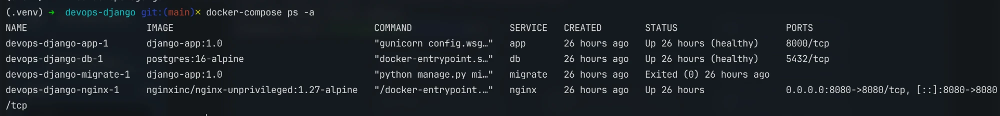

Requests through nginx, the visit counter is stored in PostgreSQL:


Published image in GitHub Container Registry:

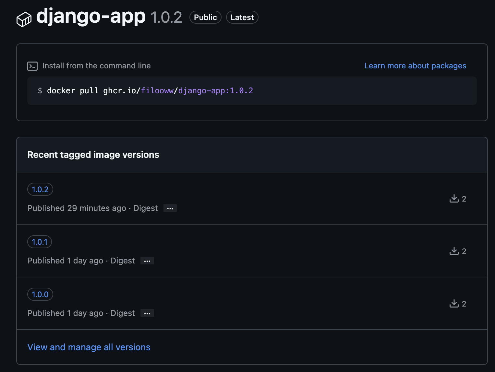

### AWS EC2 deployment

Terraform outputs after `terraform apply`:

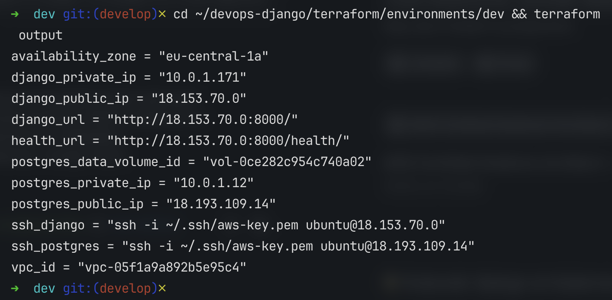

`build-push.yaml` published `latest` and the commit SHA next to the release tag:

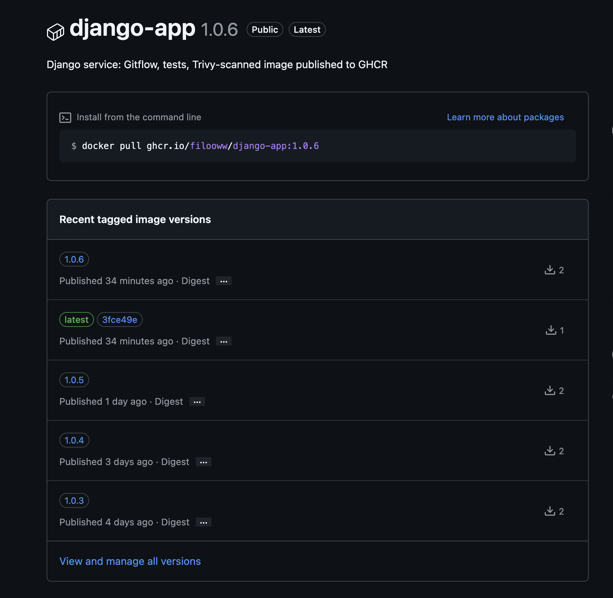

Django container on the application server, running the SHA tag with a passing health check:

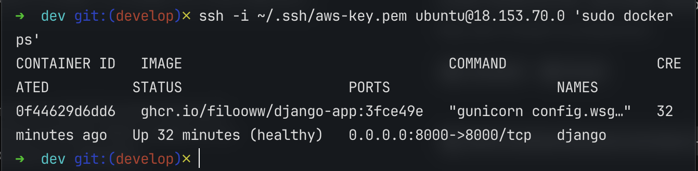

The application answers through the public IP; the visit counter is stored in PostgreSQL on the other instance:

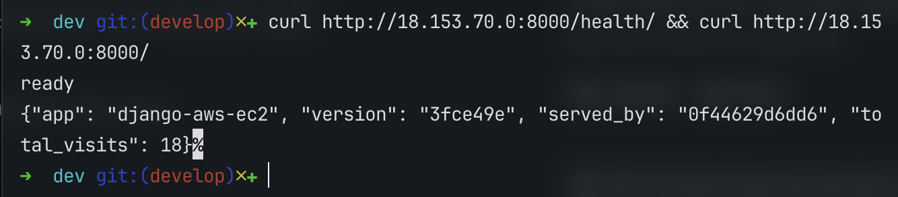

PostgreSQL data on the separate EBS volume, mounted by UUID through `/etc/fstab`:

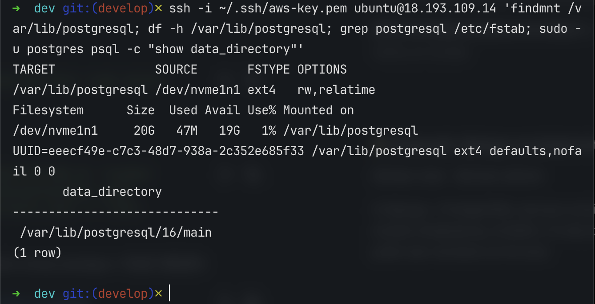

A repeated `site.yml` run changes nothing (idempotent roles):

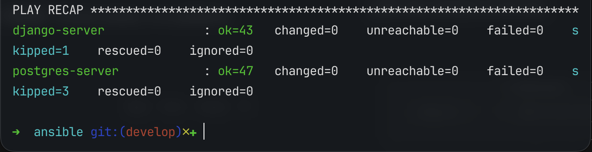

CloudWatch alarms for CPU, disk space and status checks:

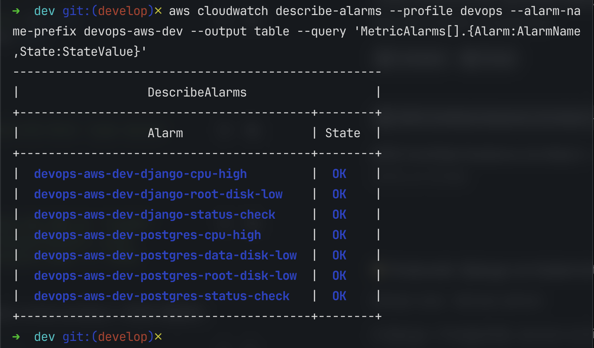

### Monitoring

Grafana, dashboard **Servers**: all three servers found by EC2 service discovery; the CPU spike on Django is the load test that fired `HighCpuUsage`:

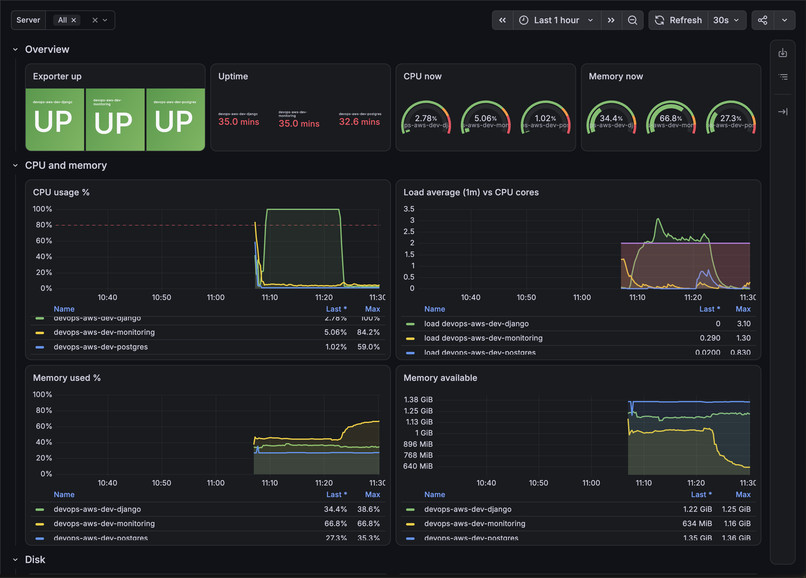

Dashboard **Application and database**: blackbox HTTP checks, PostgreSQL from postgres_exporter, containers from cAdvisor:

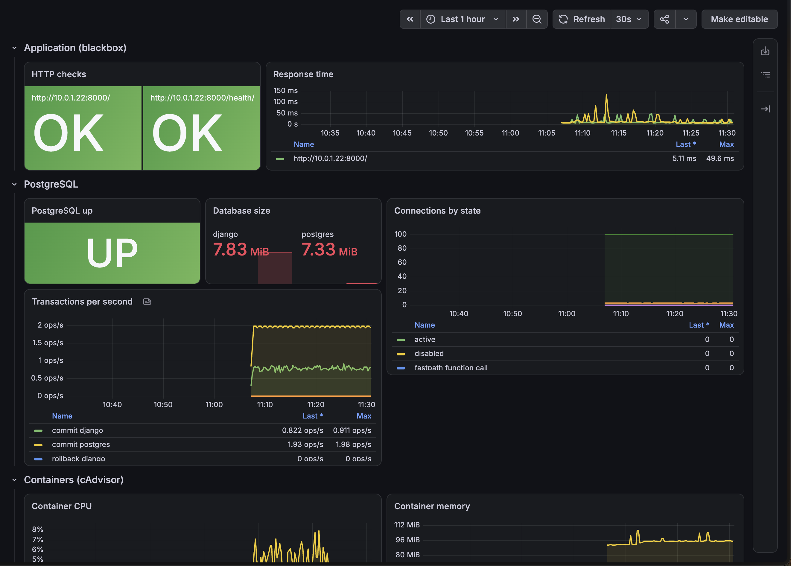

Prometheus targets: every exporter is up, EC2 discovery adds `instance`, `role`, `instance_id` and `az` labels:

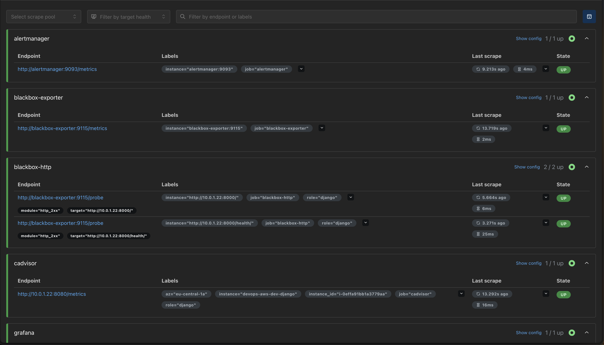

Alert rules during the disk test: `LowDiskSpace` is firing, `DiskWillFillIn24h` is pending:

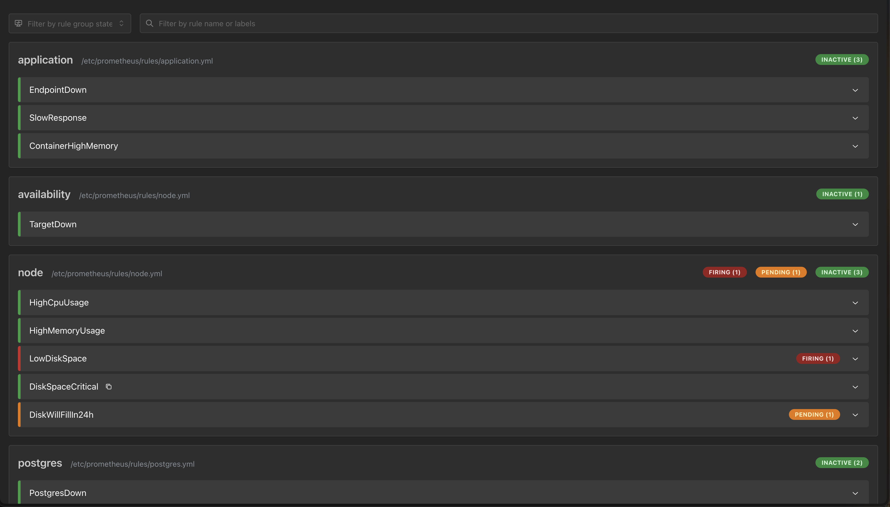

The same alert in Alertmanager, grouped by alert name and server:

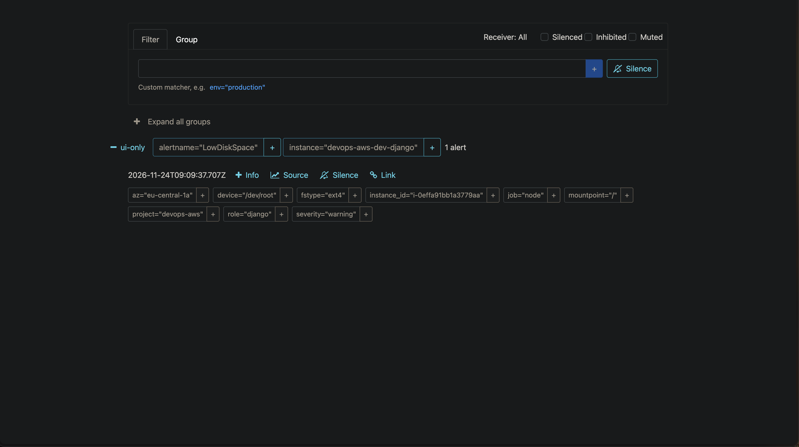
