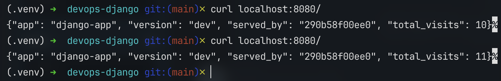

# django-app

A small Django application packaged as a Docker image. It is the application part of a DevOps assignment: the image is published to GitHub Container Registry and deployed in two ways:

- to a Kubernetes cluster with Helm and Argo CD (see [django-gitops](https://github.com/filooww/django-gitops));
- to two AWS EC2 instances with Terraform and Ansible (see [Deploy to AWS](#deploy-to-aws-ec2-terraform--ansible)).

Every request to `/` writes a row to PostgreSQL and returns the total number of visits, so it is easy to check that the app is connected to the database and that the data survives restarts.

## Project structure

```
django-app/
├── app/
│   ├── manage.py
│   ├── requirements.txt        # pinned dependencies (Django, psycopg, gunicorn)
│   ├── config/
│   │   ├── settings.py         # all settings come from environment variables
│   │   ├── urls.py
│   │   └── wsgi.py             # entry point for Gunicorn
│   └── core/
│       ├── models.py           # Visit model
│       ├── views.py            # /, /healthz, /readyz, /health/
│       └── migrations/
├── nginx/dev.conf              # reverse proxy config for local run
├── terraform/                  # AWS: state bucket, VPC, SGs, EC2, EBS, IAM, alarms
├── ansible/                    # EC2 configuration: PostgreSQL, Docker, Django, CloudWatch Agent
├── .github/workflows/
│   ├── ci.yml                  # Gitflow pipeline: lint, test, scan, push vX.Y.Z
│   └── build-push.yaml         # push to main: image :latest and :<sha>
├── Dockerfile
├── docker-compose.yaml         # local run: PostgreSQL + migrations + app + nginx
├── .env.example                # example settings
├── .dockerignore
└── .gitignore
```

## Endpoints

| Path | Description | Used for |
|---|---|---|
| `/` | Saves a visit to PostgreSQL, returns JSON with app name, version, pod/container name and total visits | Checking DB connection, load balancing |
| `/healthz` | Always returns `ok`, does not touch the DB | Docker healthcheck, Kubernetes liveness probe |
| `/readyz` | `ready` if the DB is reachable and all migrations are applied, otherwise `503` | Kubernetes readiness probe |
| `/health/` | Same check as `/readyz` | Health check of the EC2 deployment |

Example response:

```json
{"app": "django-prod", "version": "1.0.2", "served_by": "django-django-6b99956757-8qz5r", "total_visits": 10}
```

## Configuration

All configuration is passed through environment variables, nothing environment-specific is stored in the image.

| Variable | Required | Default | Description |
|---|---|---|---|
| `DJANGO_SECRET_KEY` | yes | | Django secret key |
| `DB_PASSWORD` | yes | | PostgreSQL password |
| `DB_HOST` | no | `localhost` | PostgreSQL host (`db` in Compose, Service name in Kubernetes) |
| `DB_PORT` | no | `5432` | PostgreSQL port |
| `DB_NAME` | no | `app` | Database name |
| `DB_USER` | no | `app` | Database user |
| `DJANGO_DEBUG` | no | `False` | Debug mode |
| `DJANGO_ALLOWED_HOSTS` | no | `*` | Comma-separated list of allowed hosts |
| `APP_NAME`, `APP_VERSION` | no | | Shown in the `/` response |

For the PostgreSQL container (Compose only): `POSTGRES_DB`, `POSTGRES_USER`, `POSTGRES_PASSWORD`. They must match `DB_NAME`, `DB_USER`, `DB_PASSWORD`.

## Docker image

```
ghcr.io/filooww/django-app:<version>
```

- Official `python:3.12-slim` base image, multi-stage build (dependencies are installed into a venv in a separate stage).
- Runs as a non-root user `app` (UID 999).
- No credentials inside the image: `.env` is excluded by `.dockerignore`, all secrets come from environment variables at runtime.
- Started with **Gunicorn**: `gunicorn config.wsgi:application --bind 0.0.0.0:8000 --workers 2`.
- Logs go to stdout, so they are visible in `docker logs` / `kubectl logs`.
- Migrations are a separate command: `python manage.py migrate --noinput` (a one-shot service in Compose, a Job in Kubernetes).

Build and publish a new version:

```bash
docker build -t ghcr.io/filooww/django-app:1.0.2 .
docker push ghcr.io/filooww/django-app:1.0.2
```

Published tags are never overwritten: every change gets a new version.

## Run locally with Docker Compose

```bash
cp .env.example .env      # then change the passwords
docker-compose up -d --build
curl localhost:8080/
```

Startup order is enforced with `depends_on` conditions:

```
db (healthy) → migrate (exited 0) → app (healthy) → nginx
```

- `migrate` runs `manage.py migrate` once and exits.
- `db` and `app` are in the `backend` network (`internal: true`) and are not reachable from outside; only nginx publishes a port (`8080`).
- PostgreSQL data is stored in the named volume `pgdata` and survives `down` / `up` (removed only with `down -v`).
- Containers are hardened: `read_only`, `tmpfs: /tmp`, `cap_drop: ALL`, `no-new-privileges`, CPU and memory limits.

Stop:

```bash
docker-compose down
```

## Deploy to AWS EC2 (Terraform + Ansible)

```
GitHub Actions ── push to main ──► ghcr.io/filooww/django-app:{latest, <sha>}
                                              │
Ansible (from the admin machine) ── pull ─────┘
   │
   ▼
┌───────────────────── VPC 10.0.0.0/16 ─────────────────────┐
│  Public subnet 10.0.1.0/24 ── route 0.0.0.0/0 ──► IGW      │
│                                                            │
│  Django EC2 (t3.small)            PostgreSQL EC2 (t3.small)│
│  Docker: gunicorn :8000  ──5432──► PostgreSQL 16 (apt)     │
│  SG: 8000, 22 from admin IP        SG: 5432 from Django SG │
│                                        22 from admin IP    │
│                                    EBS gp3 20 GiB, encrypted│
│                                    /var/lib/postgresql      │
└────────────────────────────────────────────────────────────┘
CloudWatch Agent on both hosts ──► metrics (CWAgent) + logs, alarms: CPU, disk, status check
```

### Responsibilities

| Tool | Does | Does not |
|---|---|---|
| Terraform | VPC, subnet, IGW, routes, security groups, EC2, EBS, IAM role, CloudWatch alarms, S3 state bucket | install software |
| Ansible | packages, users, SSH, EBS format/mount, PostgreSQL, Docker, Django container, migrations, CloudWatch Agent | create AWS resources |
| GitHub Actions | build and push the image to GHCR | connect to EC2, run Terraform or Ansible, deploy |


### Requirements

- Terraform >= 1.11, AWS CLI v2, Ansible >= 2.17, jq
- AWS CLI profile `devops` (`aws configure --profile devops`)
- EC2 key pair `aws-key`, private key at `~/.ssh/aws-key.pem` (`chmod 400`)

### 1. Remote state bucket

```bash
cd terraform/bootstrap
terraform init
terraform apply
```

Creates `devops-aws-tfstate-<account-id>` with versioning, AES256 encryption and public access blocked. Its own state stays local on purpose: the bucket cannot store the state that creates it.

### 2. Infrastructure

```bash
cd terraform/environments/dev
export TF_VAR_admin_cidr="$(curl -s https://checkip.amazonaws.com)/32"
terraform init -backend-config="bucket=$(terraform -chdir=../../bootstrap output -raw bucket_name)"
terraform validate
terraform plan
terraform apply
```

The admin IP is passed through an environment variable so it never lands in Git. State locking uses the S3 lock file (`use_lockfile = true`), no DynamoDB table is needed.

Optional: `-var alarm_email=you@example.com` creates an SNS topic for alarms (confirm the subscription email).

### 3. Secrets (Ansible Vault)

```bash
mkdir -p ~/.ansible && openssl rand -base64 32 > ~/.ansible/devops-aws-vault-pass && chmod 600 ~/.ansible/devops-aws-vault-pass
cd ansible
ansible-vault encrypt_string "$(openssl rand -base64 24 | tr -d '/+=')" --name vault_db_password >> group_vars/all.yml
ansible-vault encrypt_string "$(openssl rand -base64 48 | tr -d '\n')" --name vault_django_secret_key >> group_vars/all.yml
```

The image is public, so EC2 pulls it without a token. If the package is made private, add a token with `read:packages`:

```bash
read -rs "T?GHCR token: " && ansible-vault encrypt_string "$T" --name vault_ghcr_token >> group_vars/all.yml; unset T
```

Only encrypted values are committed. The vault password file stays outside the repository.

### 4. Image

Every push to `main` (in Gitflow that is the merge of a `release/*` PR) runs `build-push.yaml` and publishes `ghcr.io/filooww/django-app:latest` and `:<short sha>`. Argo CD Image Updater for the Kubernetes deployment only picks `X.Y.Z` tags, so these tags do not affect it.

### 5. Configure servers

```bash
cd ansible
ansible-galaxy collection install -r requirements.yml
./inventory/generate.sh
git fetch origin
ansible-playbook playbooks/site.yml -e django_image_tag=$(git rev-parse --short=7 origin/main)
```

`site.yml` runs: common → EBS → PostgreSQL → Docker → Django → monitoring.

### Deployment of a new version

```bash
gh pr merge --merge               # on the release/* branch: merge to main, build-push publishes :<sha>
git fetch origin
cd ansible
ansible-playbook playbooks/application.yml -e django_image_tag=$(git rev-parse --short=7 origin/main)
```

The `django` role pulls the image, runs `python manage.py migrate --noinput` in a one-off container, replaces the running container only if migrations succeeded, waits for the Docker health check, then checks `/health/` and `/` through the public IP and verifies the returned version.

### Data safety

- The EBS role formats the disk only when `blkid` finds no filesystem; a disk with another filesystem stops the play.
- Mount by UUID in `/etc/fstab` with `nofail`; on first mount the host reboots once to prove the mount survives.
- The EBS volume is a separate resource: replacing the EC2 instance keeps the volume and its data. `terraform destroy` deletes it, take a snapshot first if the data matters.
- PostgreSQL listens on localhost and the private IP; `pg_hba.conf` allows only the Django host's private IP for the application database.

### Destroy

```bash
cd terraform/environments/dev && terraform destroy
```

The state bucket is not removed by this; delete it from `terraform/bootstrap` when the project is finished.

### Next steps

- Elastic IP for the Django host (public IP changes after stop/start)
- Session Manager instead of SSH (the IAM role already has `AmazonSSMManagedInstanceCore`)
- Private subnet for PostgreSQL with a NAT gateway

## Screenshots

Containers started with Docker Compose (`migrate` exited with code 0, the rest are healthy):


Requests through nginx, the visit counter is stored in PostgreSQL:



Published image in GitHub Container Registry:


